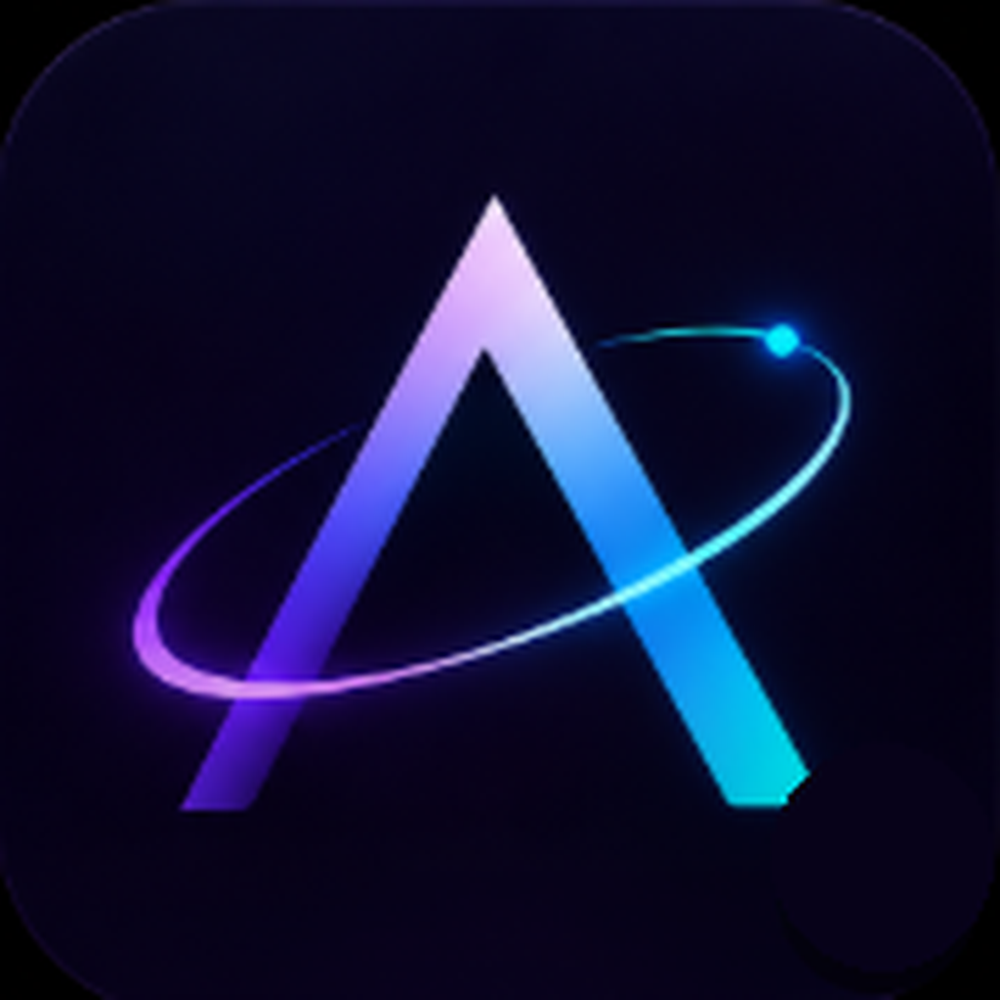

<div align="center">



# AWAKEN

### A Modern Windows Desktop Experience featuring a Dynamic Island, Intelligent Dock & Productivity Hub

</div>

---

**Awaken** makes your Windows desktop feel alive.

Every transition is a physics simulation.
Every element responds to touch.
Every pixel is in motion.

Your desktop has been asleep for years.
**Awaken** wakes it up.

---

## The Dynamic Island

A floating notch at the top of your screen that adapts to what you're doing.

Scroll or swipe to switch modes.
Watch it transform.

- **Music & Media** — Album art, track metadata, spring-physics audio visualizer reacting to five WASAPI frequency bands.
- **Social & Developer Notifications** — Live notification alerts and searchable history for WhatsApp, Telegram, Discord, Antigravity, and Claude turns.
- **Clipboard History & Image Zoom** — Multi-format clipboard monitoring with two-column preview capsules and interactive high-resolution zoom.
- **Command Center** — Wi-Fi, Bluetooth, volume, and display brightness.
- **Calendar & Focus** — Month view with an integrated Pomodoro timer.
- **Drop Shelf** — Park files, code snippets, and dragged items right on top of the notch.

---

## The Dock

A taskbar that actually moves.

Awaken replaces your native Windows taskbar with an intelligent, physics-driven dock:
- Fluid icon magnification and hover physics.
- DWM live thumbnail window previews.
- Folder stacks (Downloads, Desktop, Custom) and drive shortcuts.
- System tray popouts and Start menu integration.
- Instant taskbar restoration fail-safe: crash watchdog ensures Windows Explorer taskbar is never lost.

---

## Architecture & Technology

- **Backend:** Rust 2021, Tauri v2.11+, Windows SDK crate `windows` v0.61.
- **Frontend:** React 19, TypeScript, Vite 7, Framer Motion 12, Tailwind CSS 4, Lucide React icons.
- **Package Manager:** Bun 1.4.0+
- **Platform:** Windows 10 & 11 (64-bit)

---

## Getting Started

### Prerequisites
- [Bun](https://bun.sh/) (v1.4.0+)
- [Rust](https://rustup.rs/) (Stable `x86_64-pc-windows-msvc`)

### Build from Source

```bash
git clone https://github.com/Awaken11/Windowsdock.git
cd Windowsdock
bun install
bun run tauri dev
```

### Build Production Binary

```bash
bun run tauri build --no-bundle
```
The compiled executable will be located at `src-tauri/target/release/awaken.exe`.

---

## Attribution & License

Awaken is an independently maintained desktop shell for Windows, maintained by **Awaken11** (<Akhil.Aafriya0987@outlook.com>).
Originally derived from the open-source project Bloom by Sehajveer Singh and contributors.

Licensed under the **GNU General Public License v3.0 (GPLv3)**. See [`LICENSE`](LICENSE) for details.
